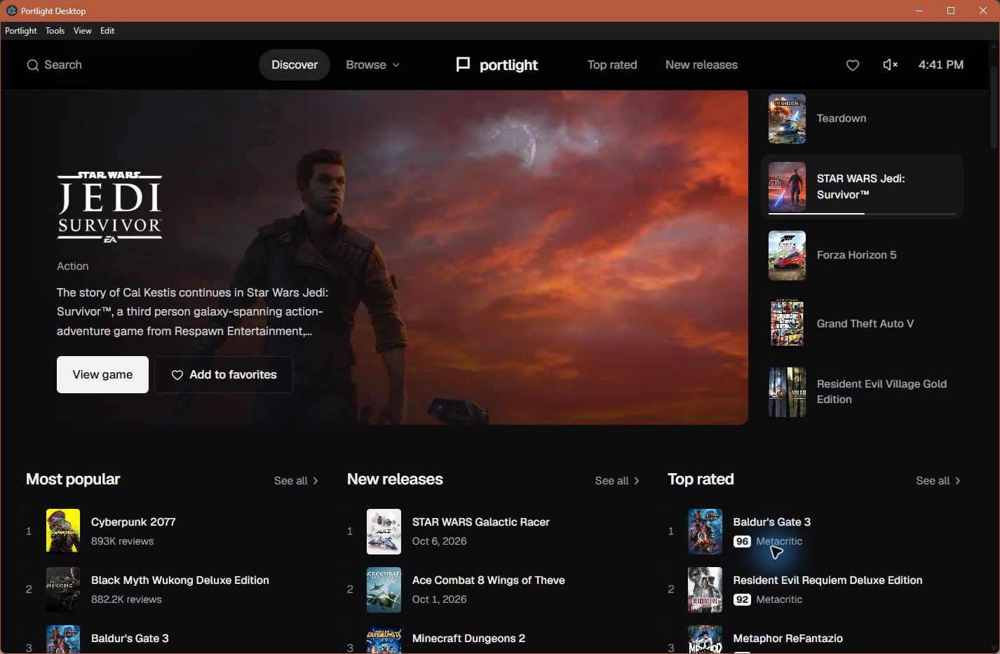

# Portlight Desktop

**An experimental Windows library and launcher built from Overdrive, with AnyPS5 integration.**

Browse a catalog, select a local ELF, prepare it with AnyPS5, and launch the resulting Windows executable from one desktop interface. Every catalog entry has Prepare and Launch controls, regardless of prior test results.

Portlight is an independent community project. Overdrive's interface and AnyPS5's porting technology are credited below. This is not an official release from either upstream project or Sony.



## What we improved

| Area | Portlight's contribution |
| --- | --- |
| Windows desktop | Packaged Overdrive's React interface inside Electron, with an isolated preload bridge and native file dialogs. |
| Preparation | Added clean ELF selection, resource copying, AnyPS5 invocation, Intel instruction-conversion selection, and per-title conversion logs. |
| Launching | Added persistent executable associations, working-directory handling, visible native game windows, process status and exit diagnostics. Launch prepares first when needed. |
| Tool setup | Added selection of a separate AnyPS5 relinker and matching runtime, saved per Windows user. Tool changes are detected before conversion. |
| Catalogs | Added validated JSON import, the full 2,069-entry catalog with original artwork links, and historical test reports. Imported entries receive the same launch controls. |
| Release hygiene | Separate application identity and user data, preserved catalog artwork links, source archive, third-party notices, checksums, and repeatable Windows packaging. |

Search, browsing, favorites, much of the visual design, and keyboard navigation originate in Overdrive. Executable conversion and graphics/system-library implementations originate in AnyPS5. We built a newer upstream AnyPS5 revision for testing; we do **not** claim to have authored its compatibility improvements.

## Windows download

Release version: **0.1.0-alpha.1**, Windows x64, unsigned portable ZIP.

1. Download `Portlight-0.1.0-alpha.1-windows-x64.zip` and extract the entire folder.
2. Run `Portlight.exe`. Node.js is not required to run the packaged app.
3. Click **Configure AnyPS5**. Select your AnyPS5 relinker `.exe`, then its matching runtime `libs` folder containing `.prx` libraries.
4. Open a game, choose **Prepare ELF with AnyPS5**, and select its clean ELF beside its resources and bundled modules.
5. Click **Launch local game**. Alternatively, attach an already prepared Windows executable.

The game opens in its own native window; Electron manages preparation and launching. Closing Portlight does not stop running games.

The download includes the full **2,069-entry catalog**, including 13 homebrew listings, with the same cover, hero, logo and screenshot URLs as the original local Overdrive catalog. **Game binaries, console modules, firmware, keys, and AnyPS5 binaries are not bundled.** The Project source links take you to the relevant upstream repositories. The launcher does not download games automatically.

AnyPS5 is a separate GPL-2.0-only program. See [tool setup](docs/ANYPS5.md) for the exact revision used in testing and build links. A successful conversion requires a suitable input and runtime; a catalog listing alone does not supply them.

App settings, executable associations, prepared copies and logs live in `%APPDATA%\Portlight Desktop`. Preparation copies resources and needs space for another game folder. Imported catalogs and favorites also remain on your PC. Artwork loads over HTTPS from the original hosts and requires internet access; remote images may change or become unavailable.

## What actually works

The integration was tested on **Windows x64, Intel Core i7-13700F, NVIDIA RTX 4060 Ti**, using AnyPS5 commit `ee496219007b05e054a469fe12330f7e38e5451a` on **2026-10-12**.

| Test | Observed result |
| --- | --- |
| DOOM Native Port | Prepared and launched from Electron; shareware menu, episode menu and 3D world rendered. The tester confirmed physical keyboard menu response. |
| ccleste | Prepared and launched from Electron; animated title screen and first level rendered after mouse input. Sustained movement was not established by the automated keyboard test. |
| ELF recovery experiment | 11 clean game ELFs recovered from plaintext homebrew containers; accepted reconstructed files matched their embedded SHA-256 values. |
| Conversion batch | 10 of those 11 game ELFs converted with the tested AnyPS5 build. |
| Startup batch | 10 converted games attempted; six remained running after 12 seconds, four exited. Remaining running was not treated as proof of playability. |

These gameplay observations came from the earlier local Overdrive-branded build using the same launcher flow. The public Portlight package was also tested with its new configuration dialogs: clicking Launch selected a local DOOM ELF, prepared it and opened the rendered shareware menu. See [validation](docs/VALIDATION.md). No commercial PS5 game, full playthrough, audio output, or physical controller has been validated by this project.

See [all 13 results](docs/COMPATIBILITY.md). Failures remain visible as diagnostics; there is no tested-title allowlist.

## Controls

AnyPS5 defaults include Enter/Space = Cross, C = Circle, I = Triangle, left mouse = Square, right mouse = R2, arrows = D-pad, WASD = left stick, Escape = Options and F11 = fullscreen. The game determines what these actions do. See [upstream input mapping](https://github.com/boykopovar/AnyPS5/blob/main/docs/user/INPUT_MAPPING.md) for controllers and remapping.

## Import a catalog

Choose **Import catalog** and select a JSON array matching [the bundled catalog](catalog/store/games.json). Catalog import does not attach or download game files. The app accepts PS4, PS5 and custom identifiers and offers the same actions for every valid entry. Use **Use bundled catalog** to restore all 2,069 listings. See [catalog format](docs/CATALOG.md).

## Build from source

Use Windows x64, **Node.js 24** and npm. The committed lockfile fixes dependency versions.

```powershell
npm ci
npm test
npm run build
npm run package
npm run verify
```

The portable directory is created under `release/`. Packaging starts from Electron's installed Windows distribution and explicitly copies only the application, notices and documentation. Run `npm start` after building to use the source checkout. See [release procedure](docs/RELEASING.md) for ZIPs, checksums and GitHub assets.

## Credits and licensing

**Overdrive — created by overdriveps5 and PS5 React contributors.**
https://github.com/overdriveps5/game-store

Portlight's frontend derives from Overdrive's web implementation, which in turn credits [Orbit Store](https://github.com/saawant12/orbit-store-ps5). The frontend and launcher modifications are distributed under **GPL-3.0-or-later**, with preserved upstream attribution terms. See [LICENSE](LICENSE), [LICENSE-ATTRIBUTION](LICENSE-ATTRIBUTION), [credits](CREDITS.md), and [third-party notices](THIRD-PARTY-NOTICES.md).

[AnyPS5](https://github.com/boykopovar/AnyPS5), by boykopovar and contributors, remains a separately installed **GPL-2.0-only** program invoked through its command line. Portlight does not relicense or embed its code. Game projects and assets retain their own licenses; downloading a project does not transfer ownership of it.

This release is unsigned and experimental. Verify the published SHA-256 checksums before extracting a download. Compatibility reports describe observations on one PC and are not promises for every game or device.
